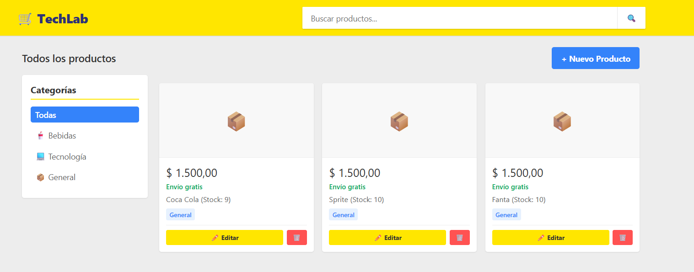

# Sistema-De-Gestion-API
API REST desarrollada con **Java** y **Spring Boot** para con los requisitos de la cursada de backend.

---

## Tecnologías utilizadas en este proyecto
* **Java**
* **Spring Boot** 
* **MySQL** 
* **Hibernate** 
* **Maven** 

---

## Arquitectura del Proyecto
El proyecto está construido por carpetas con paquetes y clases para respetar las normas de POO antes vistas:
* `controller`: Endpoints REST expuestos para la interacción con el cliente.
* `service`: Lógica de negocio, validaciones de stock y transacciones.
* `repository`: Interfaces de comunicación con la base de datos usando Spring Data JPA.
* `model`: Entidades persistentes (`Producto`, `Bebida`, `Pedido`, `LineaPedido`) con mapeo de herencia.
* `exception`: Manejo centralizado de excepciones personalizadas (`@RestControllerAdvice`).

---

## Configuración y Ejecución

1. **Clonar el repositorio:**
   ```bash
   git clone [https://github.com/HamRaw10/Sistema-De-Gestion-API.git](https://github.com/HamRaw10/Sistema-De-Gestion-API.git)
   
---

## Visualización de la página del Proyecto



En una especie de "Mercado Libre", donde se ve el producto que implemente de prueba, el cual es una coca cola, donde se puede ver el mismo producto, todo esto mediante la conexión de la base de datos con el proyecto en Java
y el mismo ya se implemento un CRUD, para facilitar al mismo
